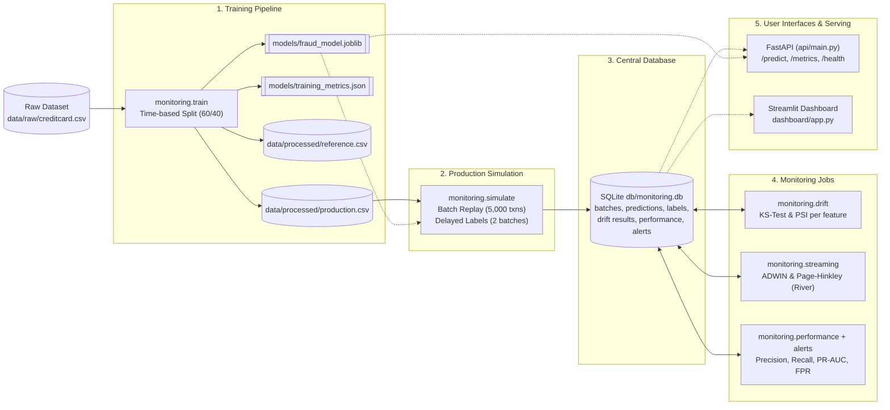

# ML Model Monitoring & Drift Detection System

An end-to-end, production-grade Machine Learning monitoring and drift detection system designed for high-stakes fraud detection workflows. 

The system trains a fraud classification model, replays production traffic with delayed ground-truth labels, runs comprehensive batch and streaming drift detection, evaluates model degradation across adaptive windows, generates alerts, and serves results via a **FastAPI** service and a **Streamlit** dashboard.

> 📖 **Full Documentation Portal:** Detailed modular guides are available in the [**`docs/`**](docs/README.md) directory:
> * [System Architecture & DB Design](docs/architecture.md)
> * [Statistical & Streaming Drift Detection](docs/drift_detection.md)
> * [Pipelines & Delayed Ground Truth](docs/pipelines.md)
> * [FastAPI Endpoint Reference](docs/api_reference.md)
> * [Streamlit Dashboard Guide](docs/dashboard.md)
> * [Production Docker & Operations](docs/deployment.md)

---

## 🏛️ System Architecture



---

## 🚀 Key Features

| Component | Technology | Description |
|---|---|---|
| **Model Pipeline** | `scikit-learn`, `joblib` | `StandardScaler` + `LogisticRegression(class_weight='balanced')` trained using strict time-based splits to prevent future data leakage. |
| **Data Drift Detection** | `scipy`, `numpy` | **Kolmogorov-Smirnov (KS) test** ($p$-value $< 0.05$) and **Population Stability Index (PSI)** using 10 quantile bins for all input features. |
| **Streaming Drift Detection** | `river` | Online change detection via **ADWIN** and **Page-Hinkley** tracking continuous output scores, flag volumes, and true prediction error rates. |
| **Delayed Ground Truth** | `pandas`, `sqlite3` | Accurately simulates real-world chargeback delays (labels arrive 2 batches later) with isolated storage tables. |
| **Performance Windows & Alerts** | `monitoring.alerts` | Rolling window evaluations when sufficient fraud cases ($\ge 30$) arrive; automated rule alerts for Recall degradation, FPR spikes, and PR-AUC drops. |
| **Prediction & Metrics API** | `fastapi`, `pydantic` | High-throughput inference scoring endpoint with input validation, duplicate prevention, and telemetry reporting. |
| **Operational Dashboard** | `streamlit`, `plotly` | 5-tab real-time monitoring interface for health overview, feature drift distributions, streaming detectors, and alert logs. |
| **Containerization** | `docker`, `docker-compose` | Non-root container with read-only model mounts, localhost network isolation, and shared persistent SQLite volume. |

---

## 📂 Project Structure

```text
├── api/
│   ├── main.py                     # FastAPI application endpoints (/predict, /health, /metrics)
│   └── example_transaction.json     # Sample transaction payload for testing
├── dashboard/
│   └── app.py                      # Streamlit 5-page monitoring dashboard
├── data/
│   ├── raw/                        # Source Kaggle creditcard.csv (git-ignored)
│   └── processed/                  # Generated reference.csv and production.csv
├── db/
│   └── monitoring.db               # SQLite database tracking all metrics and batches
├── docker/
│   └── import_db.py                # Safe atomic SQLite import utility for containers
├── models/
│   ├── fraud_model.joblib          # Trained scikit-learn pipeline (scaler + model)
│   └── training_metrics.json       # Baseline metrics saved during training
├── src/
│   └── monitoring/
│       ├── config.py               # Central project configuration, thresholds & paths
│       ├── data.py                 # Dataset loading, validation, and time-based splitting
│       ├── train.py                # Model training and baseline evaluation pipeline
│       ├── predict.py              # Scoring engine and model fingerprinting
│       ├── storage.py              # SQLite schema, transactional queries & data access
│       ├── simulate.py             # Replay engine for production data & delayed labels
│       ├── drift.py                # Statistical KS-test and PSI drift detection
│       ├── streaming.py            # River ADWIN & Page-Hinkley streaming monitors
│       ├── performance.py          # Labeled window performance evaluation
│       └── alerts.py               # Threshold-based alert rule evaluation
├── tests/                          # Comprehensive pytest test suite
├── docker-compose.yml              # Multi-service container orchestration
├── Dockerfile                      # Production Docker container definition
├── pyproject.toml                  # Package configuration & metadata
└── requirements.txt                # Pinned project dependencies
```

---

## 🛠️ Getting Started

### 1. Prerequisites & Environment Setup

This project requires **Python 3.12**.

Create and activate a virtual environment:

```bash
# Windows (PowerShell)
python -m venv .venv
.\.venv\Scripts\Activate.ps1

# Linux / macOS
python3.12 -m venv .venv
source .venv/bin/activate
```

Install dependencies:

```bash
pip install -r requirements.txt
```

### 2. Dataset Setup

1. Download `creditcard.csv` from the [Kaggle Credit Card Fraud Detection Dataset](https://www.kaggle.com/datasets/mlg-ulb/creditcardfraud).
2. Place the downloaded file into `data/raw/creditcard.csv`:
   ```bash
   # Ensure target directory exists
   mkdir -p data/raw
   # Copy creditcard.csv to data/raw/creditcard.csv
   ```

---

## ⚡ Execution Pipeline

Run each stage sequentially to initialize the pipeline:

### Step 1: Train the Baseline Model
Splits the dataset into reference (60%) and production holdout (40%), trains the model, evaluates validation metrics, and writes baseline artifacts:
```bash
python -m monitoring.train
```
*Outputs:* `models/fraud_model.joblib`, `models/training_metrics.json`, `data/processed/reference.csv`, `data/processed/production.csv`.

### Step 2: Simulate Production Traffic
Feeds production batches of 5,000 transactions into the model and logs scores into SQLite:
```bash
# Run simulation for all production data
python -m monitoring.simulate run

# Check batch status and label release state
python -m monitoring.simulate status
```

### Step 3: Run Drift Detection
Calculates Kolmogorov-Smirnov statistics and PSI for every feature across all processed batches:
```bash
python -m monitoring.drift run
python -m monitoring.drift report
```

### Step 4: Run Streaming Drift Monitors
Applies River ADWIN and Page-Hinkley algorithms to detect real-time shifts in fraud probability, flag rate, and error rate:
```bash
python -m monitoring.streaming run
python -m monitoring.streaming report
```

### Step 5: Evaluate Performance & Generate Alerts
Computes confusion matrices, Precision, Recall, and PR-AUC over completed label windows, checking against defined alert thresholds:
```bash
python -m monitoring.performance run
python -m monitoring.performance alerts
```

---

## 🖥️ Running the User Interfaces

### Streamlit Monitoring Dashboard
Launch the interactive web dashboard to visualize data drift, streaming charts, performance curves, and alerts:
```bash
streamlit run dashboard/app.py
```
Open **http://localhost:8501** in your web browser.

### FastAPI Scoring & Metrics API
Launch the REST API server:
```bash
python -m uvicorn api.main:app --host 127.0.0.1 --port 8000 --reload
```
* Interactive Swagger Docs: **http://127.0.0.1:8000/docs**
* Service Health: `GET http://127.0.0.1:8000/health`
* Live Metrics: `GET http://127.0.0.1:8000/metrics`
* Model Info: `GET http://127.0.0.1:8000/model-info`

#### Example `/predict` Request (PowerShell):
```powershell
$body = Get-Content .\api\example_transaction.json -Raw
Invoke-RestMethod -Method Post -Uri http://127.0.0.1:8000/predict -ContentType "application/json" -Body $body
```

---

## 🐳 Docker Deployment

Run the complete stack (API + Dashboard + shared SQLite database) using Docker Compose:

```bash
# Build and start services in the background
docker compose up -d --build

# Run monitoring tasks inside the container environment
docker compose --profile tools run --rm monitor python -m monitoring.drift run
docker compose --profile tools run --rm monitor python -m monitoring.performance run

# Stop services (preserves SQLite data volume)
docker compose down
```

* **API**: Accessible on `http://127.0.0.1:8000`
* **Dashboard**: Accessible on `http://127.0.0.1:8502`

---

## 🧪 Testing & Verification

Run the comprehensive test suite with `pytest`:

```bash
pytest -v
```

All unit and integration tests run on synthetic fixture data and do not require downloading the full Kaggle dataset.

---

## 🔒 Security Best Practices

* **Network Binding:** Ports in `docker-compose.yml` are bound strictly to `127.0.0.1` by default to avoid unauthenticated external exposure.
* **Model Immutability:** Model directories are mounted read-only (`:ro`) in Docker containers to prevent tampering with serialized `joblib` artifacts.
* **Input Validation:** Strict Pydantic models forbid unexpected fields, enforce numeric ranges, and reject the target `Class` column from prediction requests.
* **Database Isolation:** Parameterized queries are enforced across all database handlers to prevent SQL injection vulnerabilities.

