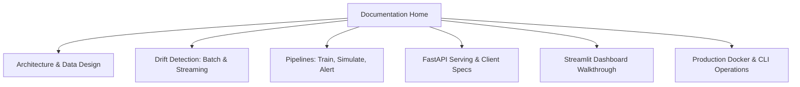

# ML Model Monitoring System — Documentation Hub

Welcome to the comprehensive technical documentation for the **ML Model Monitoring & Drift Detection System**.

This documentation covers the architectural design, statistical foundations, operational pipelines, API specifications, and deployment workflows for monitoring machine learning models in production environments.

---

## 📚 Documentation Index

| Section | Document | Description |
|---|---|---|
| **System Architecture** | [Architecture Guide](architecture.md) | High-level component interactions, data pipelines, and SQLite database schema. |
| **Statistical Drift Detection** | [Drift Detection Deep Dive](drift_detection.md) | Theory and implementation of Kolmogorov-Smirnov (KS) test, PSI, and River streaming detectors (ADWIN & Page-Hinkley). |
| **Pipelines & Simulation** | [Pipelines & Simulation](pipelines.md) | Time-based data splitting, batch replay simulation, delayed ground-truth handling, and performance windowing. |
| **API Reference** | [FastAPI Reference](api_reference.md) | Complete OpenAPI specification for `/predict`, `/metrics`, `/model-info`, and `/health` endpoints. |
| **Dashboard Guide** | [Streamlit Dashboard Guide](dashboard.md) | Overview of the 5-page interactive monitoring dashboard and visualization interpretation. |
| **Deployment & Operations** | [Deployment & Docker Guide](deployment.md) | Container setup, persistence volume management, CLI commands, and security hardening. |

---

## ⚡ Quick Navigation

---

## 🎯 System Objectives

1. **Production Observability:** Continuously monitor live model inputs and predictions without depending on immediate ground truth.
2. **Early Drift Warning:** Detect statistical data shifts before they degrade downstream business KPIs.
3. **Realistic Ground Truth Delay:** Account for real-world chargeback and fraud investigation delays (typically days to weeks) before computing supervised performance metrics.
4. **Lightweight & Self-Contained:** High-performance, zero-external-dependency infrastructure running on standard Python, SQLite, FastAPI, and Streamlit.

