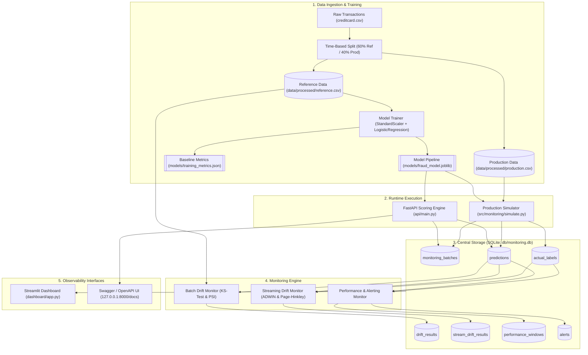
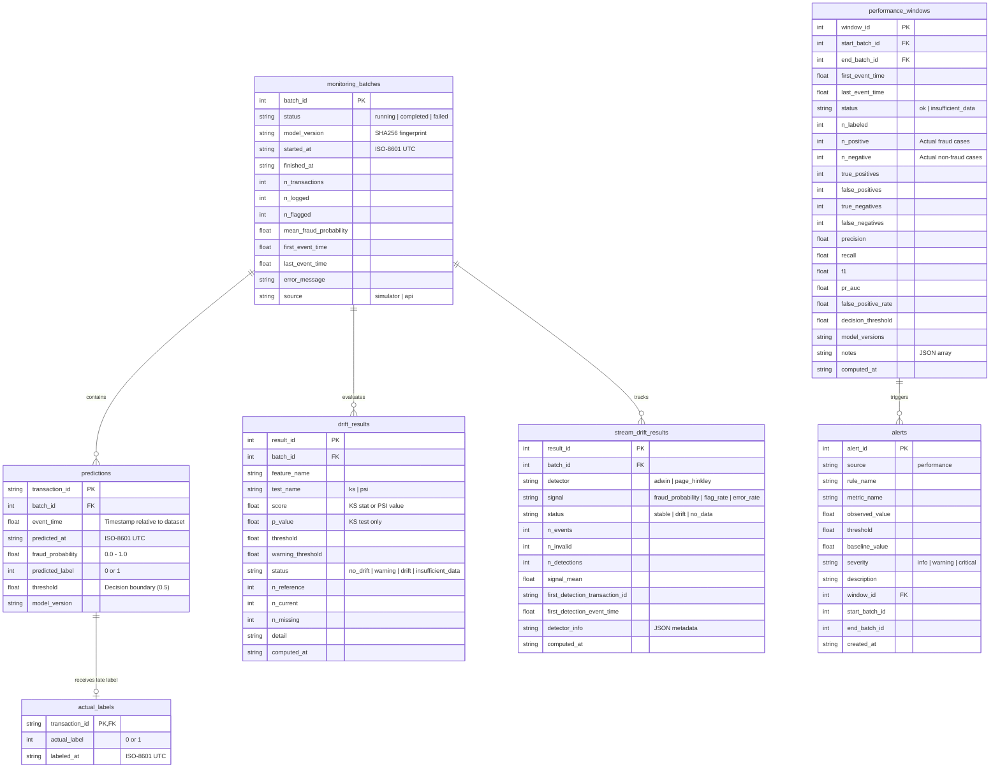

# System Architecture & Database Design

This document details the architectural blueprint, data flow mechanics, and database schema of the **ML Model Monitoring & Drift Detection System**.

---

## 🏗️ High-Level System Architecture

The architecture separates training, real-time prediction, batch simulation, asynchronous monitoring, and user visualization into dedicated modules connected through a single persistent SQLite database.

---

## 🗄️ Database Schema & Entity-Relationship Model

The central SQLite database (`db/monitoring.db`) stores transaction metadata, scoring outputs, delayed labels, and monitoring calculations. Foreign key enforcement (`PRAGMA foreign_keys = ON`) is enabled on all connections.

---

## 🔒 Key Architectural Safeguards

### 1. Label Separation Pattern
Predictions and actual ground-truth labels are intentionally stored in separate tables (`predictions` vs `actual_labels`).
* **Why:** In production fraud detection, true labels arrive weeks or months later following chargebacks and dispute resolution. Storing labels directly on prediction records would tempt training or validation queries to leak labels into production inference steps.

### 2. Batch Source Isolation (`simulator` vs `api`)
Every batch created in `monitoring_batches` includes a `source` column (`simulator` or `api`).
* **Why:** API predictions are single transactions that never receive true labels. The performance, streaming, and drift batch monitors exclusively aggregate batches where `source = 'simulator'`, preventing unlabelled real-time API traffic from blocking batch evaluation pipelines.

### 3. Read-Only Database Checks
The FastAPI scoring service and Streamlit dashboard use read-only SQLite connections (`?mode=ro&immutable=1` or `PRAGMA query_only = ON`) for health and metric reads, ensuring analytical queries cannot corrupt or lock active transactional tables.

