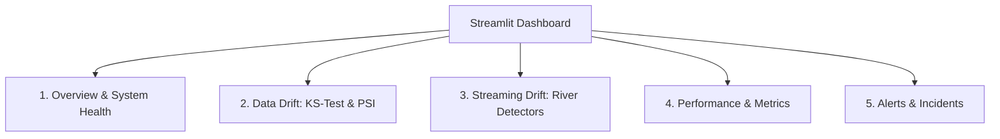

# Streamlit Monitoring Dashboard Guide

The system includes a 5-page interactive web dashboard built with **Streamlit** and **Plotly** (`dashboard/app.py`). It provides a visual operational center for machine learning engineers, fraud analysts, and system administrators.

---

## 🚀 Launching the Dashboard

```bash
# Direct local run
streamlit run dashboard/app.py

# Specify host and port
streamlit run dashboard/app.py --server.address 0.0.0.0 --server.port 8502
```

Open your browser to: **`http://localhost:8501`** (or `http://localhost:8502` if running via Docker).

---

## 📑 Dashboard Pages & Capabilities



---

### Page 1: Overview & System Health
Provides an executive snapshot of the entire monitoring environment:
* **Status Badges:** Real-time health indicators for the loaded model pipeline, SQLite database connection, and simulation progress.
* **Volume Metrics:** Total transactions scored, flagged fraud count, API scoring volume, and pending delayed labels count.
* **Pipeline Progress:** Track completed batches, active runs, and failed jobs.

---

### Page 2: Data Drift (KS-Test & PSI)
Inspects input feature distributions against the training reference baseline:
* **Batch Selector:** Choose between examining individual batches or aggregating across all historical production batches.
* **Filter Controls:** Filter features by drift status (`drift`, `warning`, `no_drift`, `insufficient_data`).
* **Interactive Plotly Visualizations:**
  * Empirical CDF overlay comparing reference data with production batch data for any selected PCA feature or transaction `Amount`.
  * Quantile bin comparison chart visualizing reference vs. production proportions and highlighting bins contributing most to high PSI scores.

---

### Page 3: Streaming Drift (River Detectors)
Visualizes event-by-event concept and prediction drift detected by River's ADWIN and Page-Hinkley algorithms:
* **Signal Filter:** Select between `fraud_probability`, `flag_rate`, and `error_rate`.
* **Detection Timeline:** Displays the exact transaction ID and event timestamp where sudden distributional or error jumps occurred.
* **Detector State Inspector:** Inspects internal window size, running mean, and accumulated drift statistics.

---

### Page 4: Performance & Metrics
Evaluates supervised model performance across closed evaluation windows:
* **Rolling Metric Curves:** Interactive line charts plotting Precision, Recall, F1, PR-AUC, and False Positive Rate across sequential windows.
* **Confusion Matrix Display:** Breakdown of True Positives, False Positives, True Negatives, and False Negatives per window.
* **Window Diagnostics:** Explanations and notes for any window where data was insufficient or classes were heavily skewed.

---

### Page 5: Alerts & Incidents
Surfaces rule violations generated by the automated alert engine:
* **Severity Filtering:** Filter alerts by `critical`, `warning`, or `info`.
* **Alert Details Table:**
  * Triggering Rule name (e.g. `recall_below_minimum`, `pr_auc_drop_from_baseline`).
  * Observed metric value vs. configured threshold.
  * Baseline metric comparison.
  * Affected batch and window range.
* **Recommended Next Steps:** Suggested remediation actions (e.g. retraining model, inspecting data pipeline drift, reviewing fraud rules).

---

## 🔒 Design & Safety Principles
* **Purely Read-Only:** The dashboard never writes, updates, or deletes records from SQLite (`open_db_readonly`).
* **Cache Management:** Uses Streamlit caching keyed to database file modification timestamp (`st.cache_data`), ensuring snappy UI response while updating automatically when new batches or labels arrive.
* **Graceful Degradation:** Displays helpful setup guidance cards if the model has not been trained yet or if the database is currently empty.

