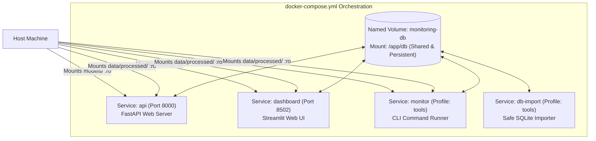

# Production Deployment & Docker Operations

This guide covers containerization, persistence volume architecture, database migrations, security configurations, and CLI operational workflows for deploying the system.

---

## 🐳 Docker Architecture Overview

The system packages the entire monitoring runtime into a single hardened Docker image, orchestrated via `docker-compose.yml`:



---

## 🛡️ Container Security Hardening

1. **Non-Root Execution:** The Dockerfile creates and switches to a dedicated unprivileged user `app` (UID/GID `1000`). Root privileges are never used during execution.
2. **Localhost Network Isolation:**
   ```yaml
   ports:
     - "127.0.0.1:${API_PORT:-8000}:8000"
     - "127.0.0.1:${DASHBOARD_PORT:-8502}:8502"
   ```
   Ports are bound strictly to `127.0.0.1` on the host to prevent accidental public exposure of unauthenticated endpoints.
3. **Read-Only Model and Data Mounts:**
   Host model artifacts and processed CSVs are mounted with `:ro` (read-only):
   ```yaml
   volumes:
     - ./models:/app/models:ro
     - ./data/processed:/app/data/processed:ro
   ```
   Containers cannot modify or tamper with trained `.joblib` models or reference CSV files.

---

## 💾 Safe Database Import (`docker/import_db.py`)

Directly copying an active SQLite database file into a running Docker volume risks file corruption due to concurrent locking. 

The `db-import` service executes an atomic import procedure using SQLite's native backup API:
1. Opens the host database in read-only and immutable mode (`?mode=ro&immutable=1`).
2. Creates a temporary backup file (`monitoring.db.importing`) using SQLite's online backup API `src.backup(dst)`.
3. Runs `PRAGMA integrity_check` on the completed copy and compares row counts across all monitoring tables.
4. Atomically replaces the target file via `os.replace`.
5. **Overwrite Protection:** Refuses to overwrite any existing database already residing in the Docker volume.

---

## ⚡ Operational Docker Commands

### 1. Starting Services
Build and start the API and Dashboard in the background:
```bash
docker compose up -d --build
```

Verify service status and healthchecks:
```bash
docker compose ps
```

### 2. Importing Existing Host Database
To copy a populated `db/monitoring.db` from your host machine into the Docker volume:
```bash
docker compose --profile tools run --rm db-import
```

### 3. Running Monitoring Tasks in Container
Execute drift or performance jobs using the `monitor` container:

```bash
# Replay simulation
docker compose --profile tools run --rm monitor python -m monitoring.simulate run

# Check data drift
docker compose --profile tools run --rm monitor python -m monitoring.drift run

# Check streaming drift
docker compose --profile tools run --rm monitor python -m monitoring.streaming run

# Check performance & alerts
docker compose --profile tools run --rm monitor python -m monitoring.performance run
```

### 4. Stopping Services
Stop and remove containers (named database volume is preserved):
```bash
docker compose down
```

To purge the persistent volume completely:
```bash
docker compose down -v
```

---

## ⚙️ Environment Variables Reference

| Variable | Default in Container | Description |
|---|---|---|
| `MONITORING_DB` | `/app/db/monitoring.db` | Absolute path to SQLite database. |
| `MONITORING_MODEL` | `/app/models/fraud_model.joblib` | Path to trained model pipeline. |
| `MONITORING_BASELINE` | `/app/models/training_metrics.json` | Path to validation metrics report. |
| `MONITORING_REFERENCE_DATA` | `/app/data/processed/reference.csv` | Path to reference split CSV. |
| `MONITORING_PRODUCTION_DATA` | `/app/data/processed/production.csv` | Path to production holdout CSV. |
| `API_PORT` | `8000` | Host port mapped to API container. |
| `DASHBOARD_PORT` | `8502` | Host port mapped to Dashboard container. |
| `MONITORING_VOLUME` | `ml-monitoring-db` | Name of Docker volume for SQLite data. |

