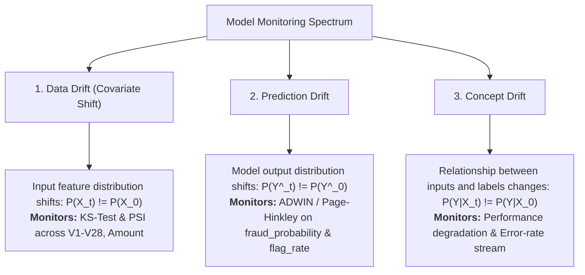

# Statistical Drift Detection Guide

This guide explains the mathematical foundations, algorithms, and thresholds used for data drift, prediction drift, and streaming concept drift detection in the system.

---

## 🔬 Types of Drift Monitored



---

## 1. Batch Data Drift: Kolmogorov-Smirnov (KS) Test

### Overview
The two-sample Kolmogorov-Smirnov test is a non-parametric statistical hypothesis test that compares the continuous empirical cumulative distribution functions (eCDFs) of two samples: reference training data ($F_{\text{ref}}$) and current batch data ($F_{\text{curr}}$).

### Mathematical Definition
Let $F_{\text{ref}}(x)$ and $F_{\text{curr}}(x)$ be the empirical distribution functions:
$$F_n(x) = \frac{1}{n} \sum_{i=1}^n \mathbf{1}_{(-\infty, x]}(X_i)$$

The KS statistic $D$ represents the maximum absolute vertical distance between the two eCDFs:
$$D = \sup_{x} \left| F_{\text{ref}}(x) - F_{\text{curr}}(x) \right|$$

* $D \in [0, 1]$: A value of $0$ indicates identical distributions; $1$ indicates completely separated samples.
* **$p$-value:** The probability of observing a supremum distance at least as large as $D$ under the null hypothesis ($H_0$: both samples are drawn from the same underlying distribution).

### Decision Rule
* **Significance Level ($\alpha$):** `0.05` (`config.KS_ALPHA`)
* If $p \text{-value} < 0.05$, the null hypothesis is rejected $\rightarrow$ **Status: `drift`**.
* If $p \text{-value} \ge 0.05$ $\rightarrow$ **Status: `no_drift`**.
* If sample size is below $50$ usable numeric values $\rightarrow$ **Status: `insufficient_data`**.

---

## 2. Batch Data Drift: Population Stability Index (PSI)

### Overview
The Population Stability Index (PSI) measures overall distributional shifts across binned ranges. It is widely used in financial credit scoring and fraud risk models to quantify divergence.

### Binned Discretization
1. Reference data is divided into $k = 10$ quantile bins (`config.PSI_N_BINS`), ensuring each reference bin contains approximately $10\%$ of training transactions.
2. The bin boundaries determined from the reference set are applied to the incoming production batch.
3. The outer bins are open-ended $(-\infty, b_1]$ and $(b_{k-1}, \infty)$ so all production values land in a valid bucket.

### Mathematical Formulation
Let:
* $R_i = \frac{n_{\text{ref}, i}}{N_{\text{ref}}}$ (Proportion of reference samples in bin $i$)
* $C_i = \frac{n_{\text{curr}, i}}{N_{\text{curr}}}$ (Proportion of current batch samples in bin $i$)

$$\text{PSI} = \sum_{i=1}^{k} (C_i - R_i) \times \ln\left( \frac{C_i}{R_i} \right)$$

#### Zero-Count Epsilon Handling
If an incoming batch has zero transactions in a particular bin, division by zero and $\ln(0)$ are prevented by clamping proportions to a minimum threshold:
$$C_i' = \max(C_i, \epsilon), \quad \text{where } \epsilon = 10^{-4} \text{ (config.PSI_EPSILON)}$$

### Industry Standard Thresholds
* **$\text{PSI} < 0.10$:** No meaningful shift (**Status: `no_drift`**).
* **$0.10 \le \text{PSI} < 0.25$:** Moderate shift requiring investigation (**Status: `warning`**).
* **$\text{PSI} \ge 0.25$:** Significant distribution shift requiring model retraining or feature review (**Status: `drift`**).

---

## 3. Streaming Drift Detection (River)

While batch monitors evaluate aggregates every 5,000 transactions, the streaming detector monitors values event-by-event in real time using the `river.drift` library.

### Monitored Streaming Signals

| Signal | Requires True Label? | Meaning & Operational Context |
|---|---|---|
| **`fraud_probability`** | No | Continuous model probability scores ($0.0 - 1.0$). Detects immediate scoring shifts. |
| **`flag_rate`** | No | Binary flag ($1$ if score $\ge 0.5$, else $0$). Detects alert volume shifts affecting review teams. |
| **`error_rate`** | Yes (delayed) | Binary classification error ($1$ if prediction $\ne$ actual label, else $0$). Detects genuine performance decay. |

---

### Algorithm 1: ADWIN (Adaptive Windowing)
ADWIN automatically manages a sliding window of historical observations with variable length:
* It increases window length when the streaming distribution is stable.
* When two sub-windows exhibit a statistically significant difference in means according to the Hoeffding bound, the older sub-window is discarded and a drift event is triggered.
* **Confidence Delta ($\delta$):** `0.002` (`config.ADWIN_DELTA`). Lower values require stronger evidence to flag drift, minimizing false positives.

### Algorithm 2: Page-Hinkley Test
The Page-Hinkley test tracks cumulative deviations from the running mean:
$$m_t = \sum_{i=1}^t (x_i - \bar{x}_i - \delta)$$
$$M_t = \max_{1 \le i \le t} (m_i)$$
$$\text{Test Statistic: } PH_t = M_t - m_t$$

* A drift alarm is triggered when $PH_t > \lambda$ (`config.PAGE_HINKLEY_THRESHOLD = 50.0`).
* **Settings:**
  * Minimum instances: `30`
  * Tolerance delta ($\delta$): `0.005`
  * Forgetting factor ($\alpha$): `0.9999`
  * Mode: `"both"` (tracks both increases and decreases in signal means).

---

## 💻 Running Drift Checks via CLI

```bash
# Run batch drift (KS & PSI) across all completed production batches
python -m monitoring.drift run

# Display batch summary report
python -m monitoring.drift report

# Inspect a single batch (e.g. batch 5)
python -m monitoring.drift report --batch-id 5

# Run streaming drift detection (ADWIN & Page-Hinkley)
python -m monitoring.streaming run

# View streaming detections for error rate
python -m monitoring.streaming report --signal error_rate
```

