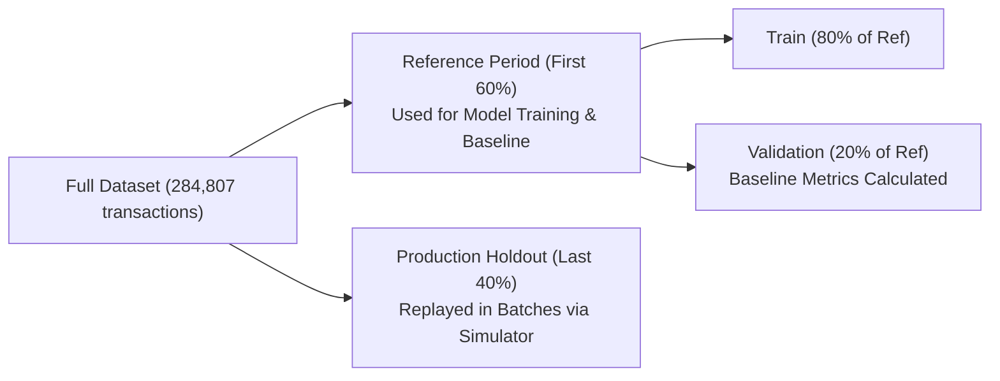
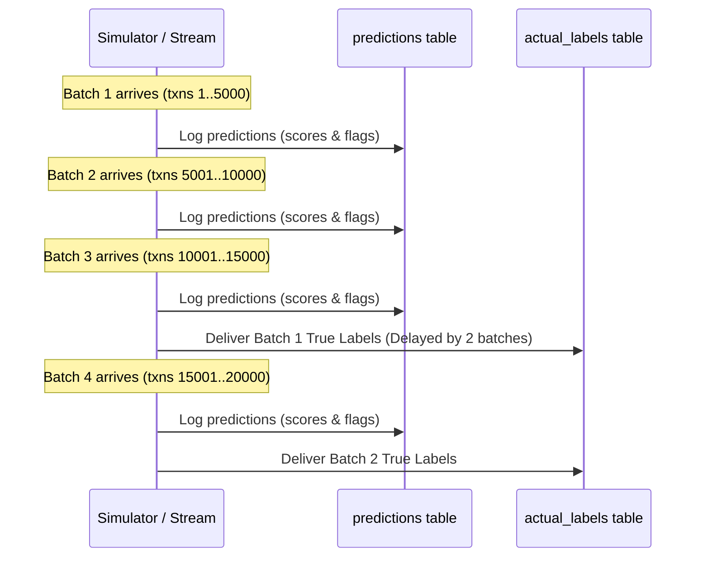

# Operational Pipelines & Delayed Ground Truth

This document explains the training pipeline, production traffic simulation, delayed label handling, adaptive performance windowing, and rule-based alerting.

---

## 1. Data Splitting & Model Training

### Why Time-Based Splitting is Essential
In fraud detection, user transaction patterns evolve over time. Random train/test splits cause data leakage from the future into the past. 
The system enforces strict chronological ordering using the `Time` column:



### Model Architecture
The model pipeline is built with `scikit-learn`:
```python
Pipeline(steps=[
    ('scaler', StandardScaler()),
    ('classifier', LogisticRegression(
        class_weight='balanced',
        max_iter=1000,
        random_state=42
    ))
])
```
* **`StandardScaler`:** Standardizes features like `Amount` and PCA components $V_1 \dots V_{28}$.
* **`class_weight='balanced'`:** Automatically adjusts weights inversely proportional to class frequencies, giving rare fraud transactions appropriate importance during optimization.
* **Decision Boundary:** Fraud probability threshold is set to `0.5` (`config.DECISION_THRESHOLD`).

---

## 2. Production Simulation & Delayed Labels

In real-world payment networks, true fraud labels are not immediately available. They arrive only after cardholders notice unauthorized transactions, file disputes, and banks confirm chargebacks (typically 14–90 days later).

### The 2-Batch Label Delay Mechanism
The production simulator (`monitoring.simulate`) replicates this dynamic:
1. Production holdout transactions are processed in consecutive chunks of $5,000$ (`config.BATCH_SIZE`).
2. When Batch $N$ is scored:
   * Predictions are inserted into `predictions` immediately.
   * True labels for Batch $N$ are withheld.
3. True labels are released into `actual_labels` only after $2$ subsequent batches have completed (`config.LABEL_DELAY_BATCHES = 2`):
   * When Batch 3 starts, Batch 1's true labels are released.
   * When Batch 4 starts, Batch 2's true labels are released.



---

## 3. Adaptive Performance Windows

### The Problem with Single-Batch Metrics
Fraud occurs in approximately $0.17\%$ of transactions. In a single batch of $5,000$ transactions, there might be only $3$ to $8$ actual fraud cases:
* Missing just $1$ fraud case would cause recall to swing from $80\%$ down to $60\%$, creating erratic false alarms.

### Solution: Sufficient-Sample Windowing
Instead of calculating performance on isolated batches, the performance monitor (`monitoring.performance`) aggregates fully labeled consecutive batches until a window meets minimum sample thresholds:
* **Minimum Actual Fraud Cases:** $\ge 30$ (`config.PERFORMANCE_MIN_POSITIVES`)
* **Minimum Actual Non-Fraud Cases:** $\ge 1,000$ (`config.PERFORMANCE_MIN_NEGATIVES`)

Once these thresholds are met, the window closes, its supervised metrics are computed, and a new window begins. Batches that do not yet have $30$ positive cases remain in an open state until more labeled batches accumulate.

---

## 4. Performance Metrics & Alert Rules

### Evaluated Supervised Metrics
For each closed performance window, the following metrics are recorded:
* **Precision:** $\frac{TP}{TP + FP}$ (Proportion of flagged transactions that were genuine fraud)
* **Recall:** $\frac{TP}{TP + FN}$ (Proportion of actual fraud cases successfully caught)
* **F1-Score:** Harmonic mean of precision and recall.
* **PR-AUC (Precision-Recall Area Under Curve):** Average precision score across all probability thresholds (the primary evaluation metric for heavily imbalanced fraud data).
* **False Positive Rate (FPR):** $\frac{FP}{FP + TN}$ (Proportion of legitimate transactions mistakenly flagged).

---

### Automated Alerting Rules

Alert rules defined in `config.PERFORMANCE_ALERT_RULES` are checked after each performance window closes:

| Rule Name | Checked Metric | Condition | Threshold | Severity | Description |
|---|---|---|---|---|---|
| `recall_below_minimum` | Recall | `below` | `0.80` | **Critical** | Triggers if the model fails to catch at least $80\%$ of actual fraud. |
| `false_positive_rate_above_maximum` | False Positive Rate | `above` | `0.05` | **Warning** | Triggers if false alarms exceed $5\%$, overwhelming fraud analysts. |
| `pr_auc_drop_from_baseline` | PR-AUC | `drop_from_baseline` | `0.10` | **Warning** | Triggers if PR-AUC drops by $> 0.10$ compared to validation baseline. |

Alerts are saved to the `alerts` table in the database and surfaced in both the API `/metrics` payload and the Streamlit dashboard.

---

## 💻 Running the Pipelines via CLI

```bash
# 1. Train model and create baseline
python -m monitoring.train

# 2. Replay production simulation
python -m monitoring.simulate run

# 3. Release pending labels (if running step-by-step)
python -m monitoring.simulate labels

# 4. Check simulator status
python -m monitoring.simulate status

# 5. Evaluate closed performance windows
python -m monitoring.performance run

# 6. Display current performance report and alerts
python -m monitoring.performance report
python -m monitoring.performance alerts
```

